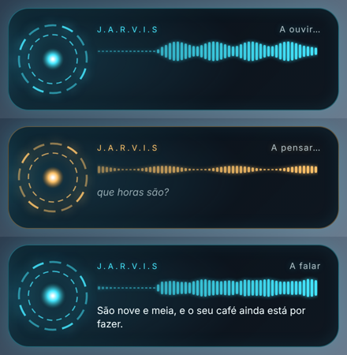
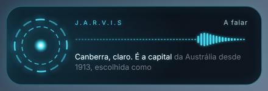

# Jarvis voice assistant (Grok + ElevenLabs)

A push-to-talk voice assistant with two front ends that share the same core:

- **Desktop:** a global **Option+Space** shortcut in the reconstructed app,
  which works even when the app is in the background.
- **Terminal:** `npm run voice`.

```text
microphone ──sox/ffmpeg──▶ ElevenLabs Scribe (speech-to-text)
                                   │
                           local intent router ──▶ instant actions (no LLM call)
                                   │ anything else
                                   ▼
                     Grok chat completions + tool calls
                                   │
                    ElevenLabs TTS (eleven_v3, emotion tags)
                                   │
                                speaker
```

- **Local intent router** (`intent-router.ts`): obvious commands such as
  "abre o Spotify", "põe o volume a 40", "que horas são?", "toma nota …" or
  "para!" run immediately, with no API call. If a local guess fails, the request
  goes to Grok instead.
- **Grok** (`grok.ts`, `assistant.ts`): questions and open-ended requests go
  to xAI's OpenAI-compatible `/chat/completions` endpoint, with function tools
  for the same actions. The conversation history is capped and trimmed only at
  user turns.
- **ElevenLabs** (`elevenlabs.ts`): Scribe for transcription, `eleven_v3` for
  speech. Grok may add tags such as `[laughs]` or `[sighs]`; the voice
  performs them and the terminal hides them.
- **Actions** (`actions.ts`): open an app, open an http(s) URL, set the volume,
  tell the time, append a note. Each action runs through `execFile` with
  validated arguments, never through a shell.
- **ASSISTANT.md** (`profile.ts`, `scheduler.ts`): a profile in the spirit of
  CLAUDE.md that sets the persona, the assistant's responsibilities, and daily
  routines. The output of each routine is spoken aloud and appended to a log
  file next to the profile.

## Desktop (Option+Space)



1. Provide `XAI_API_KEY` and `ELEVENLABS_API_KEY` in one of two ways:
   - save them in the app's encrypted secrets store, the same one that holds
     box secrets and `OPENROUTER_API_KEY`; or
   - export them and launch the app from that terminal
     (`open "dist/Grok Bot 0.18 Reconstructed.app"`). An app launched from
     Finder does not see your shell's environment variables.
2. Install a recorder: `brew install sox` (or ffmpeg).
3. Restart the app. The assistant only starts when both keys are present.

Then:

- Press **Option+Space** to start listening (you hear a *Tink*). Press it again
  to send (*Pop*). Recording stops on its own after 30 seconds.
- Replies **stream**. Grok's tokens appear in the HUD word by word as they
  arrive, and each finished sentence is sent to ElevenLabs while Grok is still
  writing the next one. Jarvis starts talking after the first sentence instead
  of waiting for the whole answer. Each word lights up exactly when it is
  spoken, using ElevenLabs character timestamps:

  
- A floating **HUD** appears at the top of the screen with an arc-reactor ring
  and a live waveform. While you speak it follows your microphone; while
  Jarvis answers it follows the reply audio. The ring turns amber while Grok
  thinks, and the HUD shows what you said and what Jarvis answers. It never
  takes focus and lets clicks pass through. It fades out a few seconds after
  Jarvis finishes. `JARVIS_HUD=off` falls back to OS notifications.
- Pressing Option+Space while Jarvis is thinking or talking interrupts it:
  the Grok stream is aborted, queued speech is dropped, and it starts listening
  again.
- Routines from `ASSISTANT.md` run in the background and are spoken when the
  assistant is idle.
- The first time, macOS asks for microphone permission. The packaged app
  declares `NSMicrophoneUsageDescription` for this.

`JARVIS_SHORTCUT` changes the shortcut (any Electron accelerator, e.g.
`CommandOrControl+Shift+J`); `JARVIS_SHORTCUT=off` turns it off. Electron's
`globalShortcut` only reports key presses, never key releases, and needs a
non-modifier key. That is why the shortcut is Option+Space toggle-to-talk
rather than holding the right Option key on its own.

Source:

- `desktop-controller.ts`: state machine (idle → listening → thinking →
  speaking) that emits HUD events;
- `source/electron-main/voice-assistant/electron-voice-assistant.ts`: the
  Electron adapter, started from `main-production-services.ts`;
- `hud-window.ts` / `hud-page.ts`: the HUD window and its page. The page runs
  sandboxed with no Node access, under a CSP that blocks all network access.
  It only receives JSON events.

Streaming (`speech-pipeline.ts`): `SentenceChunker` cuts the token stream at
sentence ends. It ignores numbers like `9.30` and merges very short fragments,
and it may cut the first sentence at a comma so the voice starts sooner.
`AudioTagFilter` hides `[laughs]`-style tags from the text even when a tag is
split across deltas; ElevenLabs still receives them. `SpeechPipeline` runs at
most two TTS requests at a time and plays sentences strictly in order. For
models that support it, it passes the earlier text as `previous_text` so
intonation carries across sentences.

Word-exact captions: with the HUD on, each sentence is synthesised through
ElevenLabs `/with-timestamps`, which returns the same PCM audio plus the start
time of every character. `alignWordStarts` maps those times to the visible
words. Characters inside `[audio tags]` count as separators, and the mapping
works whether or not the alignment includes the tags. Each word then gets its
own timer and lights up at the millisecond it begins.

If the timing does not match the visible words (for example, `Tudo[sighs]bem`
in an alignment that drops the tag), that sentence falls back to spreading the
words evenly. If the endpoint itself is refused with a 4xx error (other than
429), timestamps are switched off for the session, the failure is reported
once, and plain synthesis is used. Outages and rate limits are reported as
normal errors.

Recording streams raw PCM from sox/ffmpeg into Node, and ElevenLabs returns
raw PCM (`pcm_22050`). The waveform is computed from the same audio you hear,
with no MP3 decoder or native module.

## Terminal setup

```sh
export XAI_API_KEY=...            # https://console.x.ai
export ELEVENLABS_API_KEY=...     # https://elevenlabs.io/app/settings/api-keys
brew install sox                  # or ffmpeg; macOS plays audio with afplay
npm run voice
```

Press **Enter** to start talking and **Enter** again to stop. You can also type
a message. Replies print as they stream and are spoken sentence by sentence. Commands: `/mute`, `/routines`, `/run <routine>`, `/help`, `/quit`.
Pass `--mute` for text-only replies.

| Variable | Default |
| --- | --- |
| `GROK_MODEL` | `grok-4` |
| `XAI_BASE_URL` | `https://api.x.ai/v1` |
| `ELEVENLABS_VOICE_ID` | `JBFqnCBsd6RMkjVDRZzb` (George) |
| `ELEVENLABS_TTS_MODEL` | `eleven_v3` |
| `ELEVENLABS_STT_MODEL` | `scribe_v1` |
| `JARVIS_LANGUAGE` | `pt` (reply language and transcription hint) |
| `JARVIS_PROFILE` | `~/.grok-bot/voice-assistant/ASSISTANT.md` |
| `JARVIS_HISTORY_LIMIT` | `20` messages |

## ASSISTANT.md

The profile is created on the first run. Edit it to change the assistant's
behaviour:

```markdown
# ASSISTANT.md

## Persona
You are Jarvis, a calm, witty voice assistant. Keep answers short enough to listen to.

## What it does
Daily brief · Notes · Open apps and websites · Answer questions

## When it runs
07:00 — Daily brief → log.md
18:00 — End-of-day summary → log.md
```

Each routine runs at most once per day, while the assistant is running. A
routine whose time has already passed when the assistant starts waits until the
next day. Log files must be plain file names; they are written to the profile
directory.

## Platform notes

The assistant is built for macOS (`open`, `osascript`, `afplay`). On Linux it
uses `xdg-open`, `gtk-launch`, `pactl`, and `ffplay` or `mpg123`. On Windows,
microphone capture is not wired up yet, so use typed input there.
